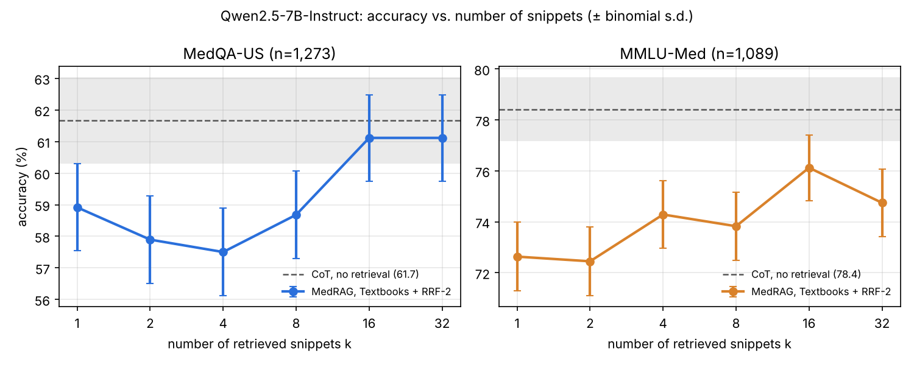

# medrag-reproduction

Reproduction of “Benchmarking Retrieval-Augmented Generation for Medicine” (Xiong et al., 2024): the MedRAG toolkit on the MIRAGE benchmark, scaled down to run on free hardware (CPU, plus the free Kaggle T4 GPU tier).

[English](#english) · [فارسی](#فارسی)

---

## English

### What is reproduced

| Component | Paper | This repo, phase 1 |
|---|---|---|
| Benchmark | MIRAGE, 7,663 questions in 5 datasets | MedQA-US (1,273) + MMLU-Med (1,089) |
| Corpus | PubMed, StatPearls, Textbooks, Wikipedia, MedCorp | **Textbooks** (18 books, 125,847 snippets; paper Table 3: 125.8k) |
| Retrievers | BM25, Contriever, SPECTER, MedCPT, RRF-2, RRF-4 | **BM25, MedCPT, RRF-2** |
| LLMs | GPT-4, GPT-3.5, Mixtral, Llama2-70B, MEDITRON-70B, PMC-LLaMA-13B | **Qwen2.5-7B-Instruct** (main), **PMC-LLaMA-13B** (to compare with the paper) |
| Settings | Zero-shot, multi-choice, RAG, question-only retrieval | same |

Textbooks fits the scaled-down setup because the paper reports it helps most on exam-style questions (MedQA, MMLU).

### Faithfulness to the original code

The official code is public domain (NCBI). Pinned reference commits:
[MedRAG@7599a72](https://github.com/Teddy-XiongGZ/MedRAG/tree/7599a728a28789fd601728c08d313b1148051f41) and
[MIRAGE@392943a](https://github.com/Teddy-XiongGZ/MIRAGE/tree/392943af99cd94cafd50a0de2e7fca24bbf65494).

- **Prompts:** copied verbatim from MedRAG `src/template.py` (`src/medrag_repro/templates.py`).
- **Context:** snippets are formatted as `Document [i] (Title: t) content` and truncated to `context_length` tokens. That is 7,168 for Qwen (MedRAG's Llama-3 budget) and 1,024 for PMC-LLaMA (MedRAG's value).
- **BM25:** Pyserini/Lucene with default parameters. **MedCPT:** CLS pooling, `[title, content]` pairs, exact inner product. **RRF:** `1/(100 + rank + 1)` over 100 hits per retriever.
- **Scoring:** the official MIRAGE `locate_answer` parser. It returns `"A"` when it cannot find an answer, so we **also** report a strict accuracy and the number of unparsable answers.
- `data/mirage_benchmark.json` is the official MIRAGE file (sha256 `6f7f08c6…f8fa`).

### Documented deviations

1. **Different models.** GPT-3.5/4 need a paid API, and 70B models do not fit on 2×T4. Only PMC-LLaMA-13B appears in the paper.
2. **Recomputed MedCPT embeddings.** The official pre-computed Textbooks embeddings returned HTTP 403 on 2026-11-08, so they are recomputed with the same encoder and settings (`scripts/embed_corpus.py`).
3. **Answer length capped** at 1,024 new tokens to bound GPU time. The number of answers that hit the cap is logged.
4. **fp16 instead of bf16**, because T4 GPUs do not support bf16.
5. **vLLM** instead of the Hugging Face pipeline, for speed. Decoding is greedy in both.

### Layout

```
src/medrag_repro/   templates.py · retrieval.py · evaluate.py
scripts/            retrieve.py · embed_corpus.py · generate.py · evaluate.py · retrieval_quality.py
templates/          pmc_llama.jinja (from MedRAG)
data/               mirage_benchmark.json
tests/              unit tests for parsing, RRF and prompts
```

### Running

```bash
pip install -r requirements.txt   # retrieval (CPU); needs Java 21 for Pyserini
python scripts/embed_corpus.py --chunk_dir textbooks/chunk --out work/medcpt_article_emb.npy   # GPU: minutes
python scripts/retrieve.py --chunk_dir textbooks/chunk --work_dir work --out retrieved/textbooks_top32.jsonl.gz
python scripts/generate.py --model Qwen/Qwen2.5-7B-Instruct --retrieved retrieved/textbooks_top32.jsonl.gz \
    --corpus corpus/textbooks.jsonl.gz --configs cot rrf2@32 --out results   # GPU
python scripts/evaluate.py --results results
```

### Results

**Qwen2.5-7B-Instruct, Textbooks corpus, 32 snippets** (full test sets; official MIRAGE parser; ± is the binomial standard deviation, as in the paper).

| Dataset | CoT (no RAG) | MedRAG, RRF-2 (k=32) | Change | Paired test (exact McNemar) |
|---|---|---|---|---|
| MedQA-US (n=1,273) | 61.67 ± 1.36 | 61.12 ± 1.37 | −0.55 | p = 0.73 (148 fixed, 155 broken) |
| MMLU-Med (n=1,089) | 78.42 ± 1.25 | 74.75 ± 1.32 | **−3.67** | **p = 0.006** (83 fixed, 123 broken) |

Strict accuracy (unparsable answers counted wrong): MedQA 61.67 / 60.57, MMLU 78.42 / 74.66. Unparsable answers: MedQA 3 / 24, MMLU 0 / 10. With RAG, 22 (MedQA) and 7 (MMLU) answers hit the length limit; most of these hit MedRAG's 8,192-token total limit, because the context alone is about 7,200 tokens.

**Reference numbers from the paper** ([arXiv:2402.13178](https://arxiv.org/abs/2402.13178), Tables 6 and 7):

| Paper setting | MMLU-Med: CoT → MedRAG | MedQA-US: CoT → MedRAG |
|---|---|---|
| GPT-3.5, Textbooks, RRF-2 (Table 7) | 72.91 → 76.68 (+3.77) | 65.04 → 65.91 (+0.87) |
| GPT-4, MedCorp, RRF-4 (Table 6) | 89.44 → 87.24 (−2.20) | 83.97 → 82.80 (−1.17) |
| Mixtral 8×7B, MedCorp, RRF-4 (Table 6) | 74.01 → 75.85 (+1.84) | 64.10 → 60.02 (−4.08) |
| PMC-LLaMA-13B, MedCorp, RRF-4 (Table 6) | 52.16 → 52.53 (+0.37) | 44.38 → 42.58 (−1.80) |

**Reading.** We do **not** reproduce the gain the paper reports for GPT-3.5 with Textbooks + RRF-2. With Qwen2.5-7B, RAG gives no change on MedQA-US and a significant drop on MMLU-Med. The paper's own Table 6 shows that on these two exam-style datasets the effect of RAG depends on the model and is negative for several (GPT-4, Llama2-70B, and PMC-LLaMA and Mixtral on MedQA), so our result is consistent with that part of the paper. Two explanations were considered: a 7B model being distracted by long contexts, and retrieved text that adds little beyond what the model already knows. The number-of-snippets sweep below tests the first.

#### Number of snippets (k)



| k | 1 | 2 | 4 | 8 | 16 | 32 | CoT |
|---|---|---|---|---|---|---|---|
| MedQA-US | 58.92 | 57.89 | 57.50 | 58.68 | 61.12 | 61.12 | 61.67 |
| MMLU-Med | 72.64 | 72.45 | 74.29 | 73.83 | 76.12 | 74.75 | 78.42 |

Paired exact McNemar test against CoT (p-values; 6 tests per dataset, so the Bonferroni threshold is 0.0083): MedQA k=1…32: 0.037, 0.005, 0.002, 0.026, 0.72, 0.73; MMLU-Med: <0.0001, <0.0001, 0.002, 0.0004, 0.081, 0.006.

- Accuracy **rises** with k, which matches the paper's Figure 3 (roughly log-linear growth for k ≤ 32, GPT-3.5, MedCorp, RRF-4).
- But with this model, RAG **never beats CoT**. Few snippets hurt the most, and 16–32 snippets only bring accuracy back to about the CoT level.
- So the "distracted by long context" explanation is **not supported**: more context helps, it does not hurt. A more likely reading is that the model leans on the few retrieved passages even when they are not the right evidence, and more snippets dilute that effect. This is a hypothesis from these numbers, not yet tested directly; a per-question check of whether the retrieved snippets contain the answer would test it.

#### Does the context contain the answer? (retrieval-quality proxy)

MIRAGE has no gold evidence for these datasets, so `scripts/retrieval_quality.py` uses a lexical proxy: an option counts as present when its text occurs in one of the top-k snippets. Questions are grouped by what the context contains, and CoT and RAG answers are compared inside each group (full table: `results/retrieval_quality/retrieval_quality.md`).

| Group (MedQA-US, k=32) | share | CoT | RAG | fixed / broken | p (McNemar) |
|---|---|---|---|---|---|
| only the correct option appears | 5.7% | 71.2 | 75.3 | 6 / 3 | 0.51 |
| only wrong options appear | 14.8% | 58.7 | 50.8 | 16 / 31 | **0.04** |
| no option appears | 71.0% | 60.2 | 59.7 | 111 / 115 | 0.84 |

- **The model follows the context.** When only wrong options appear, RAG is significantly worse than CoT on both datasets and at both k = 2 and k = 32 (p between 0.001 and 0.04). It picks a wrong option that is in the context more often than CoT does (MedQA k=32: 31.7% vs 24.9%; MMLU-Med: 21.4% vs 13.0%). When only the correct option appears, RAG tends to help, but these groups are too small to be significant.
- **Retrieval rarely finds the answer.** With 32 snippets the correct option appears in only 14% (MedQA) and 19% (MMLU-Med) of contexts. For most questions no option appears at all. In that group RAG is significantly worse at k = 2 (MedQA p = 0.012, MMLU-Med p < 0.001) and the harm shrinks with more snippets, which explains the rising k-curve.
- **Conclusion.** For this model the bottleneck is retrieval relevance (Textbooks with question-only retrieval), not context length. This agrees with the paper's finding that the choice of corpus matters most (StatPearls was best for MedQA-US in its Table 7). A manual reading of the 25 MedQA cases where RAG switched from a correct CoT answer to a wrong option present in the context (`results/retrieval_quality/manual_review_medqa_k32.md`) found that 80% of the snippets are on the question's topic but describe a neighbouring diagnosis or treatment ("near-miss" retrieval), 16% are incidental mentions, and 1 case is a proxy error. Caveats: lexical presence is not evidence (a snippet may mention a drug to rule it out), long sentence-like options (MMLU-Med) are rarely matched, and several groups and tests are compared.

**Cost.** On 2×T4 (Kaggle free tier), CoT takes about 0.3–0.5 s per question, and RAG with 32 snippets about 13.4 s per question (~8.8 GPU hours for both datasets); the k = 1…16 sweep took 0.4–5.6 s per question (~6.2 GPU hours). T4 GPUs support only the Triton/Flex attention backends in vLLM 0.33; a diagnosis of other settings is in `results/speed_diagnosis/`.

### Citation

```bibtex
@inproceedings{xiong-etal-2024-benchmarking,
  title  = {Benchmarking Retrieval-Augmented Generation for Medicine},
  author = {Xiong, Guangzhi and Jin, Qiao and Lu, Zhiyong and Zhang, Aidong},
  booktitle = {Findings of the Association for Computational Linguistics: ACL 2024},
  year   = {2024}
}
```

---

<div dir="rtl">

## فارسی

### هدف
این مخزن نتایج مقالهٔ «Benchmarking Retrieval-Augmented Generation for Medicine» (Xiong و همکاران، ۲۰۲۴) را به صورت مستقل بازتولید می‌کند. اجرا روی سخت‌افزار رایگان است: CPU برای بازیابی، و GPU رایگان T4 کاگل برای مدل زبانی.

### چه چیزی بازتولید می‌شود (مرحلهٔ ۱)
- **بنچمارک:** MedQA-US (۱٬۲۷۳ سؤال) و MMLU-Med (۱٬۰۸۹ سؤال) از MIRAGE
- **منبع دانش:** کتاب‌های درسی (Textbooks)، شامل ۱۸ کتاب و ۱۲۵٬۸۴۷ قطعه. جدول ۳ مقاله این عدد را به شکل گردشده ۱۲۵.۸ هزار آورده است.
- **روش‌های بازیابی:** BM25، MedCPT، و ترکیب این دو با RRF-2
- **مدل‌های زبانی:** Qwen2.5-7B-Instruct به عنوان مدل اصلی، و PMC-LLaMA-13B که در خود مقاله هم آمده و مقایسهٔ مستقیم را ممکن می‌کند.

### وفاداری به کد اصلی
- promptها کلمه‌به‌کلمه از کد رسمی MedRAG کپی شده‌اند.
- کوتاه‌سازی context، فرمول RRF و روش استخراج جواب دقیقاً مطابق کد رسمی است.
- کد رسمی وقتی جوابی پیدا نکند `"A"` برمی‌گرداند. به همین دلیل **دقت سخت‌گیرانه** و **تعداد جواب‌های نامفهوم** را هم جداگانه گزارش می‌کنیم تا این رفتار نتیجه را گمراه‌کننده نکند.
- کد رسمی Public Domain (متعلق به NCBI) است. commitهای مرجع در بخش انگلیسی ثبت شده‌اند.

### تفاوت‌ها با مقاله (شفاف و ثبت‌شده)
۱. **مدل‌ها:** GPT-3.5 و GPT-4 به API پولی نیاز دارند و مدل‌های 70B روی دو T4 جا نمی‌شوند.
۲. **embeddingهای MedCPT دوباره ساخته شدند:** لینک رسمی در تاریخ ۸ نوامبر ۲۰۲۶ خطای 403 داد. embeddingها با همان مدل و همان تنظیمات دوباره ساخته شدند.
۳. **سقف ۱۰۲۴ توکن برای طول جواب** تا زمان GPU محدود بماند. تعداد جواب‌هایی که به این سقف رسیده‌اند ثبت می‌شود.
۴. **fp16 به‌جای bf16**، چون GPU مدل T4 از bf16 پشتیبانی نمی‌کند.
۵. **vLLM** به‌جای pipeline هاگینگ‌فیس، برای سرعت بیشتر. روش تولید متن در هر دو حالت greedy است.

### نتایج
**مدل Qwen2.5-7B-Instruct، منبع دانش Textbooks، ۳۲ قطعه** (کل سؤال‌های آزمون، با روش رسمی MIRAGE برای استخراج جواب؛ ± انحراف معیار دوجمله‌ای است، مثل خود مقاله)

| دیتاست | بدون RAG (CoT) | با RAG (RRF-2، ۳۲ قطعه) | تغییر | آزمون آماری زوجی (McNemar دقیق) |
|---|---|---|---|---|
| MedQA-US (۱٬۲۷۳ سؤال) | ۶۱.۶۷ ± ۱.۳۶ | ۶۱.۱۲ ± ۱.۳۷ | ۰.۵۵− | p = 0.73 (۱۴۸ درست‌شده، ۱۵۵ خراب‌شده) |
| MMLU-Med (۱٬۰۸۹ سؤال) | ۷۸.۴۲ ± ۱.۲۵ | ۷۴.۷۵ ± ۱.۳۲ | **۳.۶۷−** | **p = 0.006** (۸۳ درست‌شده، ۱۲۳ خراب‌شده) |

**مقایسه با مقاله:** مقاله برای GPT-3.5 با Textbooks و RRF-2 بهبود گزارش کرده است: در MMLU-Med از ۷۲.۹۱ به ۷۶.۶۸، و در MedQA از ۶۵.۰۴ به ۶۵.۹۱ (جدول ۷). ما این بهبود را با Qwen2.5-7B **بازتولید نکردیم**. ولی جدول ۶ خود مقاله نشان می‌دهد که روی این دو دیتاست امتحانی، اثر RAG به مدل بستگی دارد و برای چند مدل منفی است: برای GPT-4، Llama2-70B، و برای PMC-LLaMA و Mixtral روی MedQA. پس نتیجهٔ ما با این بخش از مقاله سازگار است.

**دو توضیح احتمالی بررسی شد:** یکی اینکه context طولانی حواس مدل 7B را پرت می‌کند، و دیگری اینکه متن بازیابی‌شده چیزی بیش از دانسته‌های خود مدل اضافه نمی‌کند. آزمایش تعداد قطعه‌ها در ادامه، توضیح اول را می‌سنجد.

#### تعداد قطعه‌ها (k)

| k | 1 | 2 | 4 | 8 | 16 | 32 | بدون RAG |
|---|---|---|---|---|---|---|---|
| MedQA-US | ۵۸.۹۲ | ۵۷.۸۹ | ۵۷.۵۰ | ۵۸.۶۸ | ۶۱.۱۲ | ۶۱.۱۲ | ۶۱.۶۷ |
| MMLU-Med | ۷۲.۶۴ | ۷۲.۴۵ | ۷۴.۲۹ | ۷۳.۸۳ | ۷۶.۱۲ | ۷۴.۷۵ | ۷۸.۴۲ |

- دقت با **بیشتر شدن k بالا می‌رود.** این روند با شکل ۳ مقاله سازگار است: رشد تقریباً لگاریتمی تا k=32، که مقاله با GPT-3.5 و MedCorp و RRF-4 گزارش کرده است.
- ولی با این مدل، RAG **در هیچ kای از حالت بدون RAG بهتر نشد.** کم بودن قطعه‌ها بیشترین ضرر را دارد. با ۱۶ تا ۳۲ قطعه، دقت فقط به حدود سطح بدون RAG برمی‌گردد.
- پس فرضیهٔ «context طولانی حواس مدل را پرت می‌کند» **تأیید نشد**: context بیشتر کمک می‌کند، نه ضرر.
- توضیح محتمل‌تر این است که مدل به چند قطعهٔ بازیابی‌شده تکیه می‌کند، حتی وقتی آن قطعه‌ها شاهد درستی نیستند. با قطعه‌های بیشتر، این اثر رقیق می‌شود. این هم فقط فرضیه‌ای است که از این اعداد برداشت شده و هنوز مستقیم آزمایش نشده.
- نمودار و آزمون‌های آماری (McNemar با اصلاح Bonferroni) در بخش انگلیسی آمده‌اند.

#### آیا context جواب را دارد؟ (معیار تقریبی کیفیت بازیابی)
MIRAGE برای این دیتاست‌ها شاهد درست (gold evidence) ندارد. برای همین `scripts/retrieval_quality.py` از یک معیار تقریبی واژگانی استفاده می‌کند: یک گزینه «حاضر» است اگر متنش در یکی از k قطعهٔ بازیابی‌شده آمده باشد.

- **مدل از context پیروی می‌کند:**
  - وقتی فقط گزینه‌های غلط در context هستند، RAG در هر دو دیتاست و هر دو k (یعنی 2 و 32) به شکل معنادار بدتر از حالت بدون RAG است (p بین ۰.۰۰۱ و ۰.۰۴).
  - در این حالت، مدل بیشتر گزینهٔ غلطی را انتخاب می‌کند که در متن آمده است. مثلاً در MedQA با k=32، این نرخ ۳۱.۷٪ با RAG است، در برابر ۲۴.۹٪ بدون RAG.
- **بازیابی به‌ندرت جواب را پیدا می‌کند:**
  - با ۳۲ قطعه، گزینهٔ درست فقط در ۱۴٪ (MedQA) و ۱۹٪ (MMLU-Med) از contextها هست.
  - در بیشتر سؤال‌ها هیچ گزینه‌ای در متن نیست. در این گروه، RAG با k=2 به شکل معنادار ضرر می‌زند و با قطعه‌های بیشتر این ضرر کم می‌شود. همین روند صعودی منحنی k را توضیح می‌دهد.
- **نتیجه:** برای این مدل، گلوگاه مرتبط بودن بازیابی است، نه طول context. این با یافتهٔ مقاله سازگار است که «انتخاب منبع دانش مهم‌ترین عامل است».
- **بررسی دستی:** ۲۵ سؤال MedQA را خواندم که در آن‌ها RAG جواب درستِ بدون RAG را به گزینهٔ غلطِ داخل متن تغییر داد. نتیجه:
  - در ۸۰٪ موارد، قطعه دربارهٔ همان موضوع سؤال است، ولی تشخیص یا درمانِ مشابهِ دیگری را توضیح می‌دهد (بازیابیِ «نزدیک ولی اشتباه»).
  - در ۱۶٪ موارد، گزینه فقط گذرا نام برده شده.
  - یک مورد خطای خود معیار بود.
- **محدودیت‌ها:** حضور واژگانی یک گزینه به معنای شاهد بودن آن نیست؛ گزینه‌های جمله‌ای MMLU کمتر پیدا می‌شوند؛ و چندین گروه و آزمون با هم مقایسه شده‌اند. جدول و آزمون‌ها در بخش انگلیسی آمده‌اند.

**هزینه:** روی دو T4 رایگان کاگل، CoT حدود ۰.۳ تا ۰.۵ ثانیه برای هر سؤال طول می‌کشد و RAG با ۳۲ قطعه حدود ۱۳.۴ ثانیه، یعنی حدود ۸.۸ ساعت GPU برای هر دو دیتاست. آزمایش k = 1 تا 16 بین ۰.۴ تا ۵.۶ ثانیه برای هر سؤال طول کشید، جمعاً حدود ۶.۲ ساعت GPU.

</div>
